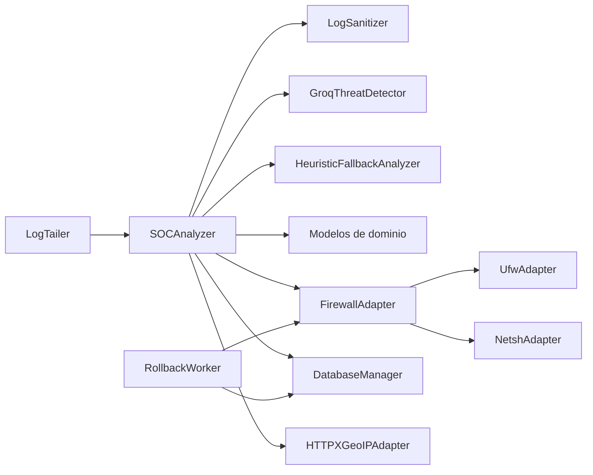

# Arquitectura

El analizador mantiene un pipeline secuencial y separa el dominio de los efectos
externos. `soc_agent.py` continúa siendo una fachada retrocompatible durante la
migración.



Árbol modular relevante:

```text
src/ai_soc/
├── domain/models.py
├── adapters/
│   ├── database.py
│   ├── geo.py
│   ├── llm.py
│   └── firewall/{base,ufw,netsh}.py
├── common/logging.py
└── services/
    ├── analyzer.py
    ├── heuristic.py
    ├── rollback.py
    ├── sanitizer.py
    └── tailer.py
```

## Capas

- **Dominio** (`src/ai_soc/domain`): contratos y validación de amenazas; no
  conoce infraestructura.
- **Adaptadores** (`src/ai_soc/adapters`): SQLite y comandos de firewall,
  aislando efectos externos.
- **Servicios** (`src/ai_soc/services`): `SOCAnalyzer` coordina la
  sanitización (`LogSanitizer`), la detección estructurada
  (`GroqThreatDetector`) y `HeuristicFallbackAnalyzer`; `LogTailer` y
  `RollbackWorker` aíslan los bucles de I/O y rollback.
- **GeoIP** (`src/ai_soc/adapters/geo.py`): `HTTPXGeoIPAdapter` usa HTTPS,
  timeout, reintentos y caché con TTL.
- **Compatibilidad** (`soc_agent.py`): API existente y CLI hasta completar la
  migración.

## Contratos de datos

- `ThreatItem`: `ip` es una dirección IP válida, `tipo` es texto y `severidad`
  pertenece a `Baja`, `Media`, `Alta` o `Crítica`.
- `ThreatReport`: contiene una lista de `ThreatItem` bajo `amenazas`.
- `DatabaseRecord`: representa una amenaza persistida con `id` opcional,
  expiración, estado activo y los mismos datos de clasificación.
- `FirewallAdapter.block_ip` y `unblock_ip` devuelven `True` solo si el comando
  del sistema termina correctamente.
