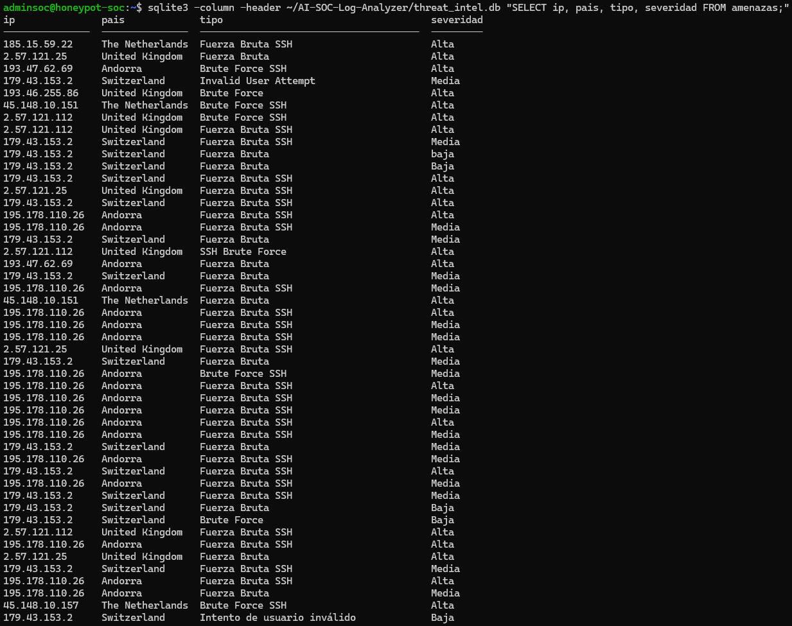
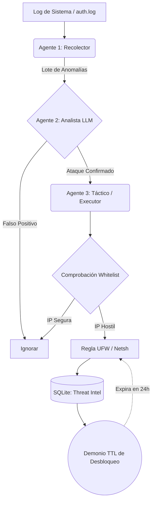

# 🛡️ Multi-Agent AI SOC Framework

<div align="center">


</div>

Un sistema avanzado de Detección y Prevención de Intrusiones (IPS/IDS) basado en una arquitectura Multi-Agente orquestada con **LangGraph**. Analiza en tiempo real registros del sistema (SSH, Apache, Nginx), clasifica amenazas utilizando Inteligencia Artificial y ejecuta contramedidas de bloqueo automatizadas (SOAR) con mecanismos de rollback.

## 🚀 Características Principales

* **Arquitectura de Grafos (LangGraph):** División lógica entre Agente Recolector (Parser), Agente Analista (LLM) y Agente Táctico (Executor).
* **Motor LLM Híbrido:** Local (Ollama) para máxima privacidad, o Nube (Groq API) para despliegues en servidores de bajos recursos.
* **Despliegue en Producción (Honeypot):** Testeado en un entorno real desplegando la herramienta en una máquina virtual de Microsoft Azure, mitigando ataques automatizados de internet en tiempo real.
* **SOAR con Rollback Inteligente (TTL):** Bloqueo dinámico en milisegundos a través de `netsh` (Windows) o `ufw` (Linux). Incluye un demonio en segundo plano que libera IPs automáticamente según un temporizador (ej. 24h) para evitar la saturación del firewall.
* **Threat Intel estructurado (SQLite):** Enriquecimiento de datos con geolocalización IP en tiempo real y persistencia relacional.
* **Seguridad en Producción:** Soporte nativo de *Whitelists* para evitar bloqueos accidentales de administradores o subredes internas.

> **Demostración:** Base de datos `SQLite` tras 48h desplegado como Honeypot en Azure capturando ataques reales.
> 
> 

## 🧠 Arquitectura del Sistema



## 🛠️ Stack Tecnológico

* **Core:** Python 3.10+, Docker, SQLite.
* **IA & Orquestación:** LangChain, LangGraph, Ollama, Groq.
* **Infraestructura:** Integración OS Firewall, CI/CD con GitHub Actions, Pytest, Microsoft Azure.

## ⚙️ Instalación y Despliegue

### Opción 1: Docker (Recomendado para Producción)
```bash
docker build -t ai-soc .
docker run --privileged --network host -v /var/log/auth.log:/app/auth.log -v $(pwd)/threat_intel.db:/app/threat_intel.db ai-soc --log /app/auth.log --ai groq --groq-key "TU_API_KEY"
```

### Opción 2: Entorno Local
1. Clona el repositorio e instala dependencias:
```bash
git clone [https://github.com/juaanmgg/AI-SOC-Log-Analyzer.git](https://github.com/juaanmgg/AI-SOC-Log-Analyzer.git)
cd AI-SOC-Log-Analyzer
python -m venv venv
source venv/bin/activate
pip install -r requirements.txt
```
2. Crea tu archivo `whitelist.txt` y añade tu IP para no quedarte fuera.

## 💻 Uso de la CLI

**Modo Privacidad Total (IA Local vía Ollama) con 12h de Ban:**
```bash
sudo python soc_agent.py --log /var/log/auth.log --ai ollama --ban-time 12 --whitelist whitelist.txt
```

### Argumentos
* `--log`: Ruta al archivo de registro.
* `--threshold`: Intentos anómalos mínimos (Default: 3).
* `--ai`: Proveedor del LLM (`ollama` o `groq`).
* `--ban-time`: Horas de duración del bloqueo antes del rollback (Default: 24).
* `--whitelist`: Ruta al archivo TXT con IPs protegidas.

## 🚧 Limitaciones y Trabajo Futuro

* **Soporte de Logs:** Actualmente optimizado para registros planos tipo syslog (`auth.log`). Se planea integrar soporte nativo para el formato estructurado de Windows Event Viewer (EVTX).
* **Escalabilidad DB:** Utiliza SQLite para facilitar el despliegue. En entornos de gran volumen, se valorará la migración a PostgreSQL o exportación directa a JSONL para ingesta en ElasticSearch/Logstash.
* **Agentes concurrentes:** El análisis por lotes maneja ráfagas eficientemente, pero se investigará el uso de `asyncio` dentro de los nodos de LangGraph para ingestas extremas.
