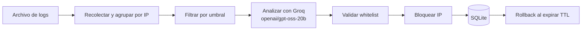

# AI SOC Log Analyzer

<<<<<<< HEAD


Analizador de logs para un SOC que detecta patrones sospechosos, consulta un LLM para clasificar amenazas y ejecuta respuestas de firewall con rollback automático por TTL.
=======
<div align="center">


</div>

Un sistema avanzado de Detección y Prevención de Intrusiones (IPS/IDS) basado en una arquitectura Multi-Agente orquestada con **LangGraph**. Analiza en tiempo real registros del sistema (SSH, Apache, Nginx), clasifica amenazas utilizando Inteligencia Artificial y ejecuta contramedidas de bloqueo automatizadas (SOAR) con mecanismos de rollback.
>>>>>>> 98cecb003755d727385238d21281aeff9538593a

## Arquitectura

<<<<<<< HEAD
El proyecto utiliza un pipeline secuencial, no una arquitectura multiagente:
=======
* **Arquitectura de Grafos (LangGraph):** División lógica entre Agente Recolector (Parser), Agente Analista (LLM) y Agente Táctico (Executor).
* **Motor LLM Híbrido:** Local (Ollama) para máxima privacidad, o Nube (Groq API) para despliegues en servidores de bajos recursos.
* **Despliegue en Producción (Honeypot):** Testeado en un entorno real desplegando la herramienta en una máquina virtual de Microsoft Azure, mitigando ataques automatizados de internet en tiempo real.
* **SOAR con Rollback Inteligente (TTL):** Bloqueo dinámico en milisegundos a través de `netsh` (Windows) o `ufw` (Linux). Incluye un demonio en segundo plano que libera IPs automáticamente según un temporizador (ej. 24h) para evitar la saturación del firewall.
* **Threat Intel estructurado (SQLite):** Enriquecimiento de datos con geolocalización IP en tiempo real y persistencia relacional.
* **Seguridad en Producción:** Soporte nativo de *Whitelists* para evitar bloqueos accidentales de administradores o subredes internas.

> **Demostración:** Base de datos `SQLite` tras 48h desplegado como Honeypot en Azure capturando ataques reales.
> 
> 

## 🧠 Arquitectura del Sistema
>>>>>>> 98cecb003755d727385238d21281aeff9538593a



La separación entre recolección, análisis y ejecución mantiene el flujo fácil de probar sin introducir agentes autónomos ni una capa de orquestación innecesaria.

<<<<<<< HEAD
## Características
=======
* **Core:** Python 3.10+, Docker, SQLite.
* **IA & Orquestación:** LangChain, LangGraph, Ollama, Groq.
* **Infraestructura:** Integración OS Firewall, CI/CD con GitHub Actions, Pytest, Microsoft Azure.
>>>>>>> 98cecb003755d727385238d21281aeff9538593a

- Monitorización de logs tipo syslog, SSH, Apache y Nginx.
- Clasificación estructurada mediante Groq y `openai/gpt-oss-20b`.
- Bloqueo con `netsh` en Windows o `ufw` en Linux.
- Whitelist para evitar bloqueos accidentales.
- Persistencia de amenazas y expiración en SQLite.
- Hilo de rollback que elimina automáticamente los bloqueos expirados.

## Requisitos

- Python 3.10 o superior.
- Una clave `GROQ_API_KEY`.
- Permisos suficientes para modificar el firewall.

## Instalación local

```bash
git clone https://github.com/juaanmgg/AI-SOC-Log-Analyzer.git
cd AI-SOC-Log-Analyzer
python -m venv venv
source venv/bin/activate  # En Windows: venv\Scripts\activate
pip install -r requirements.txt
```

Configura la clave:

```bash
export GROQ_API_KEY="TU_API_KEY"
# PowerShell:
# $env:GROQ_API_KEY = "TU_API_KEY"
```

Añade las IP protegidas a `whitelist.txt`, una por línea.

## Uso

```bash
python soc_agent.py \
  --log /var/log/auth.log \
  --threshold 3 \
  --ban-time 12 \
  --whitelist whitelist.txt
```

Argumentos:

- `--log`: ruta del archivo de log que se monitoriza.
- `--threshold`: número mínimo de eventos por IP antes de consultar el LLM (por defecto: `3`).
- `--ban-time`: duración del bloqueo en horas (por defecto: `24`).
- `--whitelist`: archivo de IPs exentas (por defecto: `whitelist.txt`).
- `--groq-key`: clave Groq; si no se proporciona, se usa `GROQ_API_KEY`.

El modelo usado es fijo: `openai/gpt-oss-20b`. Ollama y LangGraph no forman parte del runtime.

## Docker

Construye la imagen:

```bash
docker build -t ai-soc .
```

Ejecuta el analizador pasando la clave sin incluirla en la imagen:

```bash
docker run --privileged --network host \
  -e GROQ_API_KEY="TU_API_KEY" \
  -v /var/log/auth.log:/app/auth.log:ro \
  -v "$(pwd)/threat_intel.db:/app/threat_intel.db" \
  ai-soc --log /app/auth.log --whitelist /app/whitelist.txt
```

## Desarrollo y pruebas

```bash
ruff check .
pytest test_soc_agent.py
```

Las pruebas mockean el LLM, la geolocalización y los comandos de firewall; no necesitan una API key ni modificar el firewall real.
